<p align="center"><a href="README.md">🇬🇧 English</a> · <b>🇮🇹 Italiano</b></p>

<p align="center">
  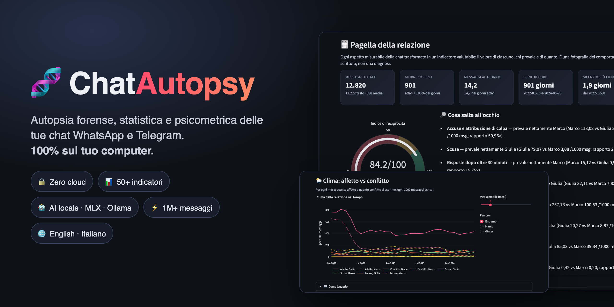
</p>

<p align="center">
  <a href="https://github.com/giuseppegambino92/ChatAutopsy/actions/workflows/ci.yml"></a>
  
  
  
  
  <a href="LICENSE"></a>
</p>

<p align="center">
  <b>Indichi un file o una cartella di export. ChatAutopsy costruisce tutto da solo e ti mostra chi cerca chi,<br>
  chi fa aspettare, quanto affetto e quanto conflitto, come cambia la relazione nel tempo. Senza che un solo messaggio lasci il tuo computer.</b>
</p>

---

## Indice

- [Perché ChatAutopsy](#perché-chatautopsy)
- [Avvio rapido](#avvio-rapido)
- [Come esportare una chat](#come-esportare-una-chat)
- [Tour della dashboard](#tour-della-dashboard)
- [Tutte le metriche, spiegate](#tutte-le-metriche-spiegate)
- [AI Detective e modello locale](#ai-detective-e-modello-locale)
- [Riga di comando](#riga-di-comando)
- [Architettura](#architettura)
- [Prestazioni](#prestazioni)
- [Privacy e sicurezza](#privacy-e-sicurezza)
- [Configurazione](#configurazione)
- [Sviluppo](#sviluppo)
- [FAQ e risoluzione problemi](#faq-e-risoluzione-problemi)
- [Avvertenze](#avvertenze)

> Tutte le schermate di questa pagina vengono da **una chat inventata** (Giulia & Marco, 900 giorni, 12.820 messaggi)
> generata da [`chatautopsy/demo.py`](chatautopsy/demo.py). I numeri sono quelli **reali** calcolati dall'app su quella chat:
> puoi riprodurli con `./start.sh demo --lang it` e rigenerare le immagini con `python scripts/make_screenshots.py`.

## Perché ChatAutopsy

- **🔒 Zero cloud.** Parsing, statistica, ricerca e intelligenza artificiale girano in locale. Nessuna API esterna,
  nessuna telemetria. Gli export caricati restano in memoria; su disco finisce solo un database SQLite che puoi
  cancellare in modo sicuro.
- **⚡ Tutto automatico.** Un comando o un trascinamento: parsing, database, indice full-text, punteggi, ricerca
  semantica. Anche il modello AI si sceglie, si scarica e si avvia da un pannello.
- **📊 Ogni aspetto è valutabile.** Oltre 50 indicatori, ognuno con il valore di ciascuno, chi prevale, di quanto e
  un riquadro *Come leggerlo*. Una **pagella** riassume tutto in un indice di reciprocità 0-100.
- **🧠 AI che cita le prove.** L'AI Detective risponde interrogando SQL, ricerca ibrida e un dossier statistico, e
  ancora ogni affermazione a messaggi reali con data e ora.
- **🏋️ Scala reale.** Testato su una chat da 1,3 milioni di messaggi e 8 anni di storia.
- **🌐 Italiano e inglese.** Interfaccia bilingue (selettore 🌐 nella barra laterale) e lessici curati in entrambe le lingue
  (affetto, conflitto, scuse, accuse, gaslighting…); la lingua della chat viene riconosciuta da sola.

## Avvio rapido

```bash
git clone https://github.com/giuseppegambino92/ChatAutopsy.git
cd ChatAutopsy
./start.sh analyze ~/Downloads/ChatExport_2024-06-28     # costruisce tutto e apre la dashboard
```

| Vuoi… | Comando |
|---|---|
| aprire solo la dashboard (e caricare il file da lì) | `./start.sh` |
| provare con la chat inventata | `./start.sh demo` |
| preparare anche il modello AI durante l'analisi | `./start.sh analyze PERCORSO --llm` |
| solo statistiche, il più veloce possibile | `./start.sh analyze PERCORSO --embeddings none` |

Su macOS puoi anche fare **doppio clic su `ChatAutopsy.command`**.

La prima esecuzione crea l'ambiente in `.venv` e installa le dipendenze (qualche minuto, una volta sola); poi parte
subito. `start.sh` cerca da solo un Python ≥ 3.10 (anche quello di Homebrew) e, se manca, propone di installarlo.

<details>
<summary><b>Installazione manuale con pip</b></summary>

```bash
python3 -m venv .venv && source .venv/bin/activate
pip install -e ".[all]"          # [embeddings] = ricerca semantica, [mlx] = AI su Apple Silicon
chatautopsy analyze PERCORSO
```

Con `pip install chatautopsy` (fuori dal repository) i dati vanno in `~/.chatautopsy`.
</details>

## Come esportare una chat

| App | Come | Cosa indicare a ChatAutopsy |
|---|---|---|
| **WhatsApp** (iPhone/Android) | chat → nome del contatto/gruppo → *Esporta chat* → **Senza media** | lo `.zip`, la cartella scompattata o il file `_chat.txt` |
| **Telegram Desktop** | chat → ⋮ → *Export chat history* → formato **HTML** o **JSON**, senza foto | la cartella `ChatExport_…` (o il suo `.zip`) |
| **Telegram, tutto l'account** | Impostazioni → Avanzate → *Export Telegram data* → JSON | `result.json` + `--chat "Nome chat"` (default: la più grande) |

Formati riconosciuti automaticamente: WhatsApp iOS e Android, 12h/24h e ordine data di ogni lingua, messaggi su più
righe, media omessi ("immagine omessa", `<Media omessi>`, *image omitted*…), messaggi di sistema filtrati;
Telegram JSON (chat singola o export completo) e HTML (pagine multiple, date in italiano/inglese/francese/
tedesco/spagnolo/portoghese, risposte, sticker, inoltri). Gli **inoltri** vengono riconosciuti ed esclusi dalle
metriche linguistiche: un articolo inoltrato non è "linguaggio tuo".

## Tour della dashboard

<p align="center">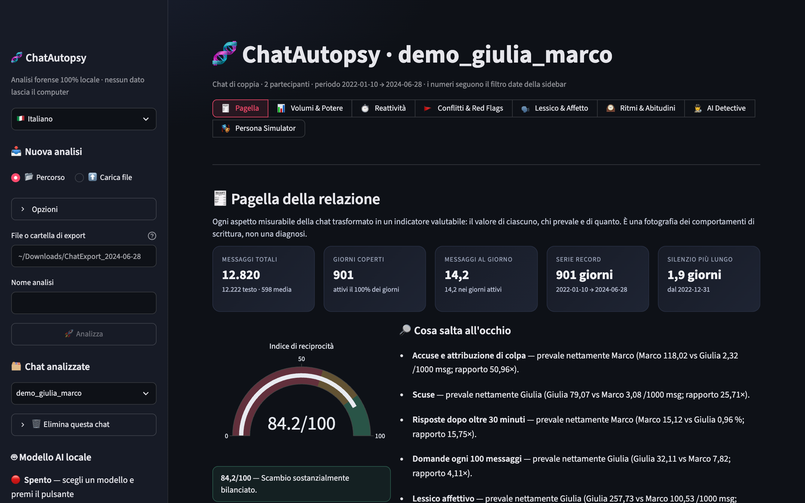</p>

A sinistra tutto il flusso: **percorso o upload → analisi automatica → chat analizzate → modello AI**. In alto otto
sezioni, calcolate solo quando le apri (le altre si preparano in background).

<table>
<tr>
<td width="32%" valign="top">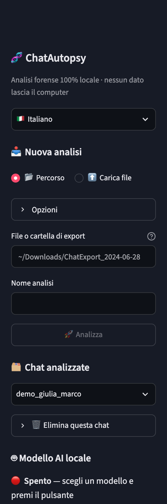</td>
<td valign="top">

**Barra laterale**

- **📂 Percorso** — incolla una cartella o un file (`~/Downloads/ChatExport_…`): il nome dell'analisi viene proposto in automatico.
- **⬆️ Carica file** — trascina uno o più file: l'analisi parte da sola.
- **Opzioni** — ricerca semantica *Veloce* (MiniLM, 470 MB), *Alta qualità* (bge-m3, 2,2 GB) o *Nessuna*.
- **🗂️ Chat analizzate** — passa da una chat all'altra, oppure eliminala con **wipe sicuro**.
- **🤖 Modello AI locale** — stato (🟢 pronto · 🟡 download/avvio · 🔴 spento), modello consigliato per la tua RAM, *Scarica e avvia*.
- **📅 Periodo analizzato** — tutte le metriche seguono il filtro date.

</td>
</tr>
</table>

### 🧾 Pagella della relazione

<p align="center">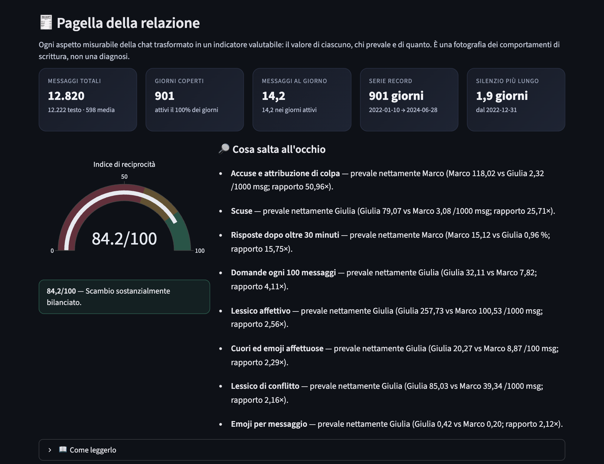</p>

Cinque numeri chiave, l'**indice di reciprocità** (qui **84,2/100**: scambio sostanzialmente bilanciato) e le frasi
generate automaticamente sugli squilibri più forti. Nella demo spiccano le **accuse** (Marco 118 contro Giulia 2,3 ogni
1000 messaggi), le **scuse** (Giulia 79 contro Marco 3,1) e le **risposte lente** (oltre 30 minuti: Marco 15,1%,
Giulia 1,0%).

<p align="center">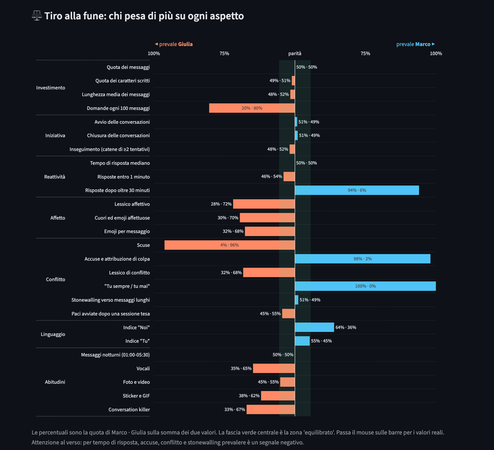</p>

Il **tiro alla fune** mette 27 indicatori su un'unica scala: ogni barra parte dalla parità e si allunga verso chi
prevale. La fascia verde è la zona "equilibrato" (rapporto tra i due < 1,25). Sotto, la tabella completa con valori,
unità, verdetto (🟢 equilibrato · 🟡 lieve · 🔴 forte prevalenza), rapporto ed export CSV.

<p align="center">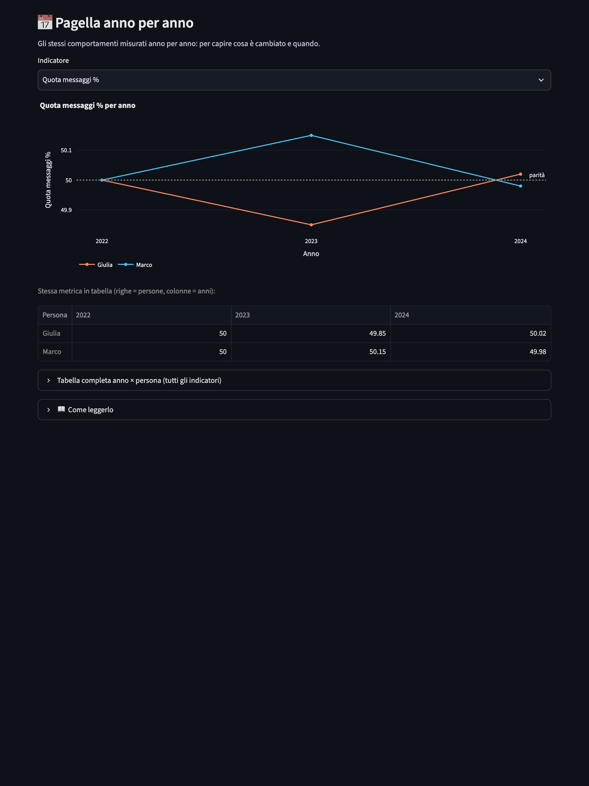</p>

La **pagella anno per anno** mostra gli stessi 14 indicatori per ogni anno: quota, avvii, latenza, lunghezza,
domande, affetto, conflitto, scuse, colpe, emoji, ore notturne, vocali e media.

### 📊 Volumi & Potere

<p align="center">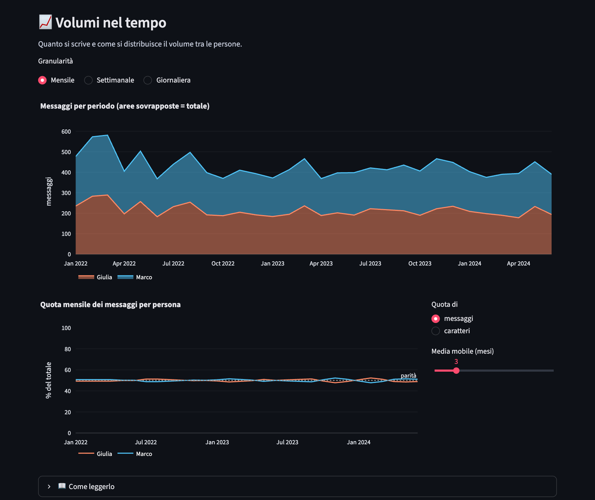</p>
<p align="center">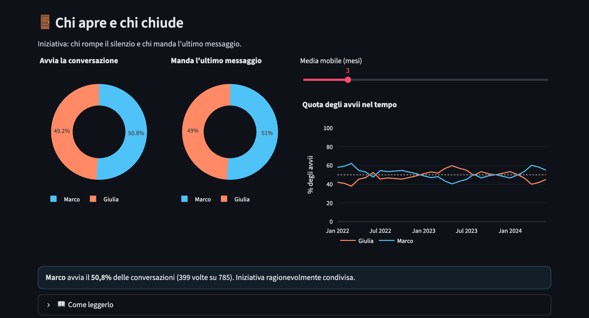</p>
<p align="center">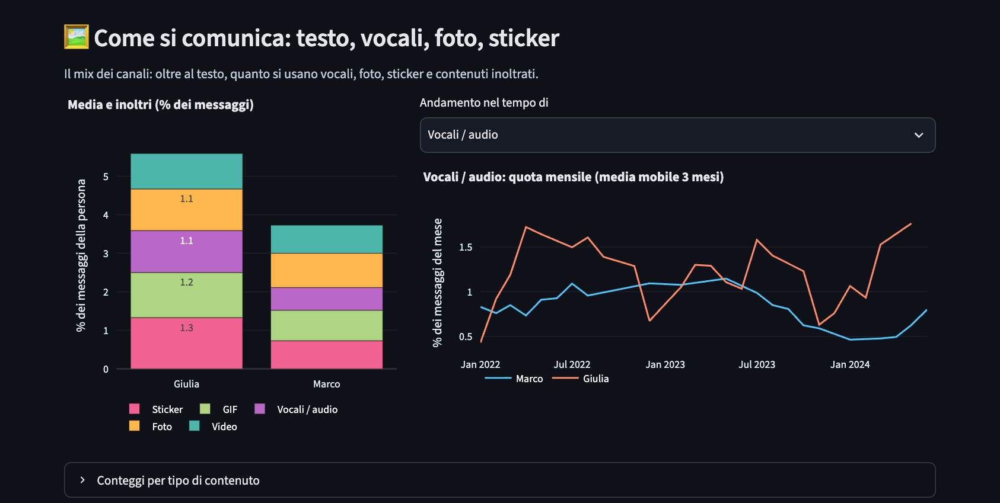</p>

Volumi e quote rispetto alla parità, **chi apre** (primo messaggio dopo 6 ore di silenzio) e **chi chiude**,
inseguimento (double/triple texting), sforzo (caratteri, domande), distribuzione delle lunghezze, **mix dei canali**
e il confronto *love bombing vs svalutazione* tra primi e ultimi 60 giorni. Nella demo l'indice di svalutazione è
**70** per Marco e **44** per Giulia: entrambi in "svalutazione marcata", come previsto dalla trama inventata.

### ⏱️ Reattività

<p align="center">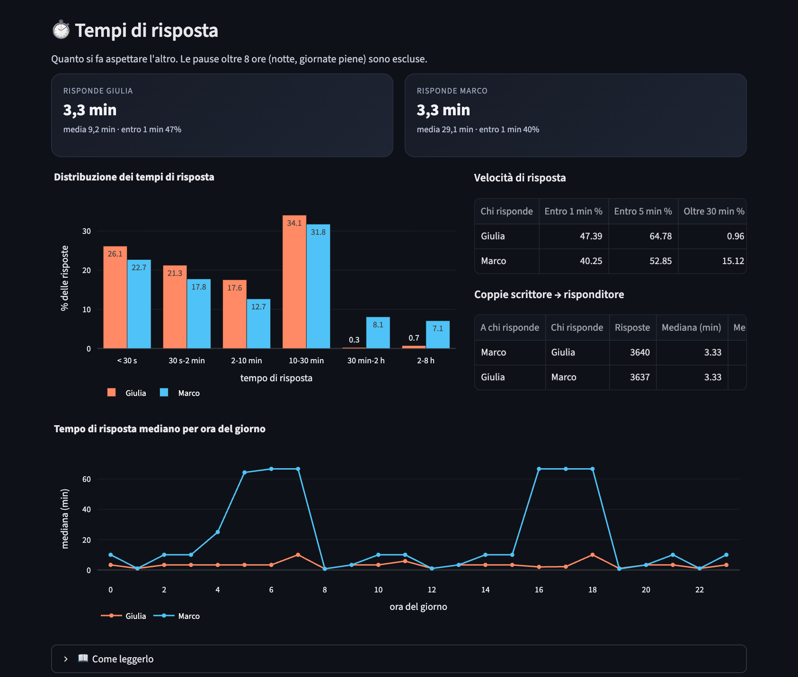</p>

Distribuzione dei tempi di risposta per fasce, velocità (entro 1 minuto, entro 5, oltre 30, oltre 2 ore) e tempo
mediano per **ora del giorno**. Il **fading detector** confronta gli ultimi 3 mesi con la mediana storica: nella
demo segnala **Marco** (da 3,3 a 66,7 minuti, z robusto 2,8) e considera Giulia stabile.

### 🚩 Conflitti & Red Flags

<p align="center">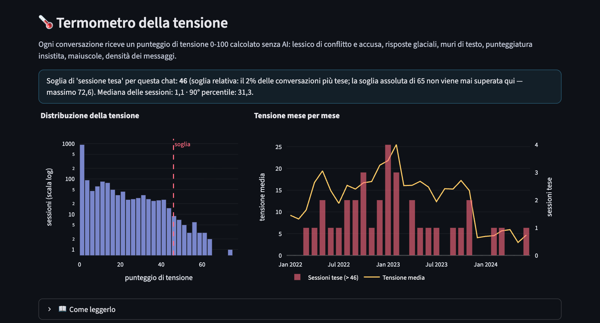</p>

Ogni conversazione riceve un **punteggio di tensione 0-100** senza AI: lessico di conflitto e accusa, risposte
glaciali, muri di testo, punteggiatura insistita, maiuscole, densità. La soglia di "sessione tesa" è **calibrata
sulla chat** (top 2% delle sessioni, qui **46**): una coppia pacata e una burrascosa hanno soglie diverse. Le
raffiche di risate ed emoji positive smorzano il punteggio (×0,4) per non scambiare l'ilarità per litigio.

<p align="center">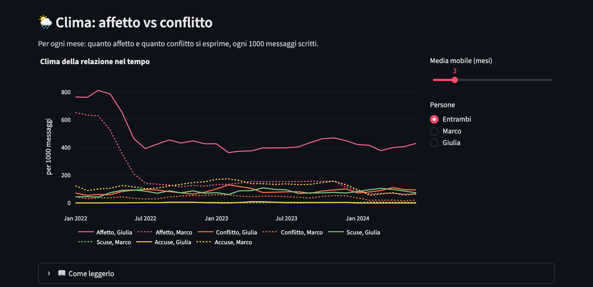</p>
<p align="center">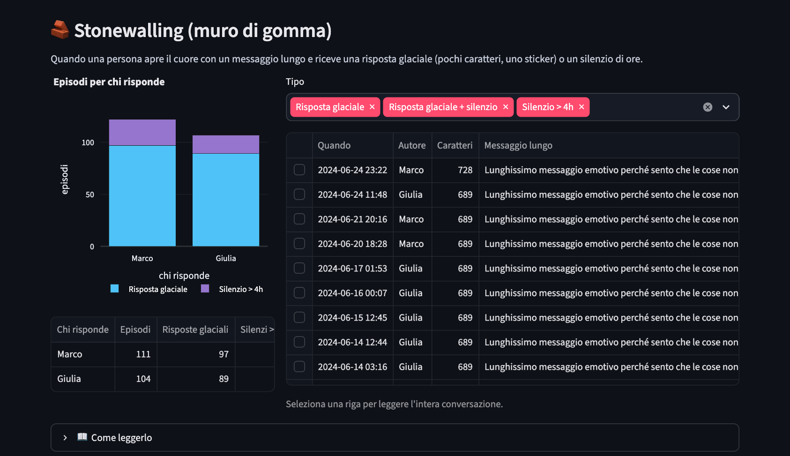</p>

Poi il **clima** (affetto, conflitto, scuse e accuse ogni 1000 messaggi), i **pronomi** "noi / io / tu" alla
Gottman, lo **stonewalling** (messaggio lungo e personale seguito da risposta glaciale o silenzio di ore; link e
inoltri esclusi), scuse e accuse, **chi fa pace per primo** (Giulia 18 volte, Marco 15), gaslighting,
passivo-aggressività e colpevolizzazione con esempi reali, le 20 conversazioni più tese con trascrizione completa e
la mappa giorno × ora dei litigi.

### 🗣️ Lessico & Affetto

<p align="center">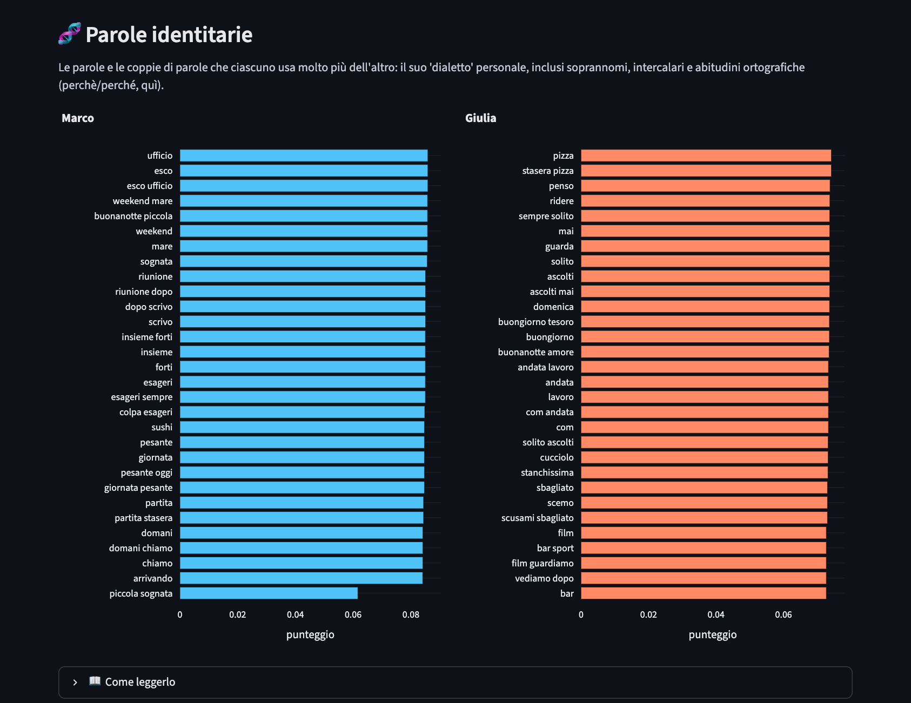</p>
<p align="center">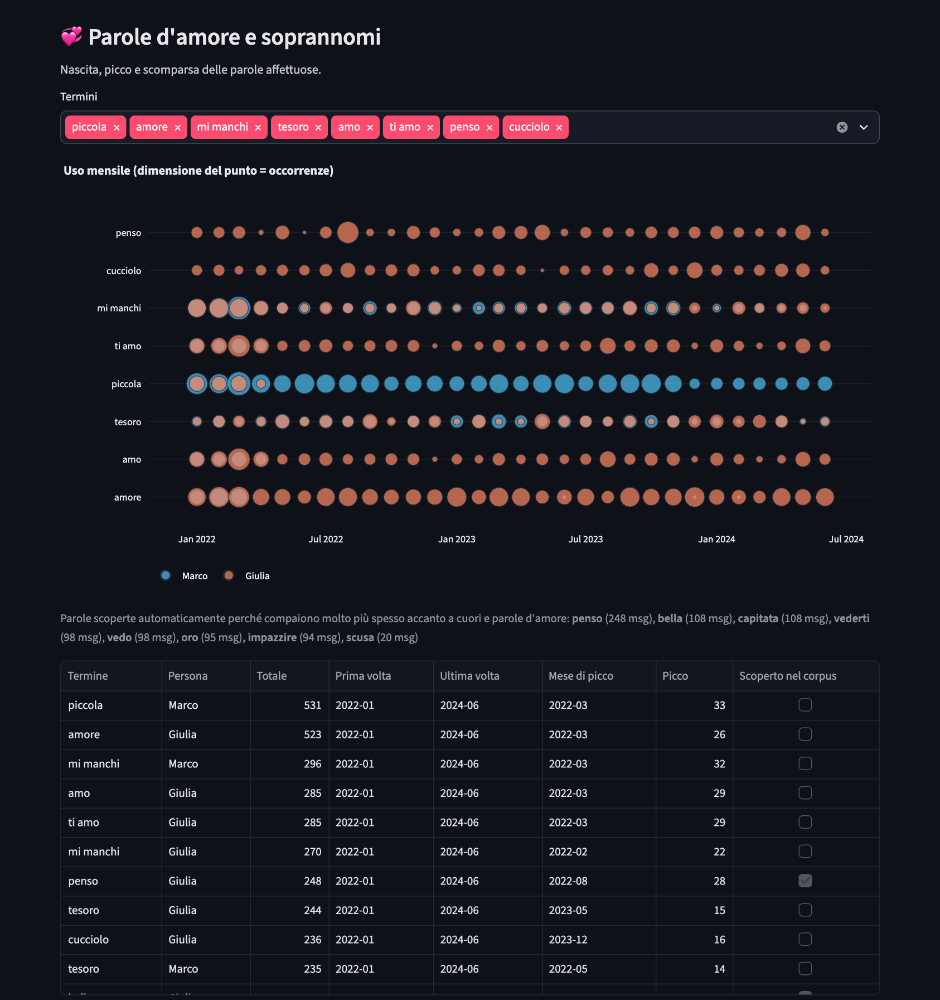</p>
<p align="center">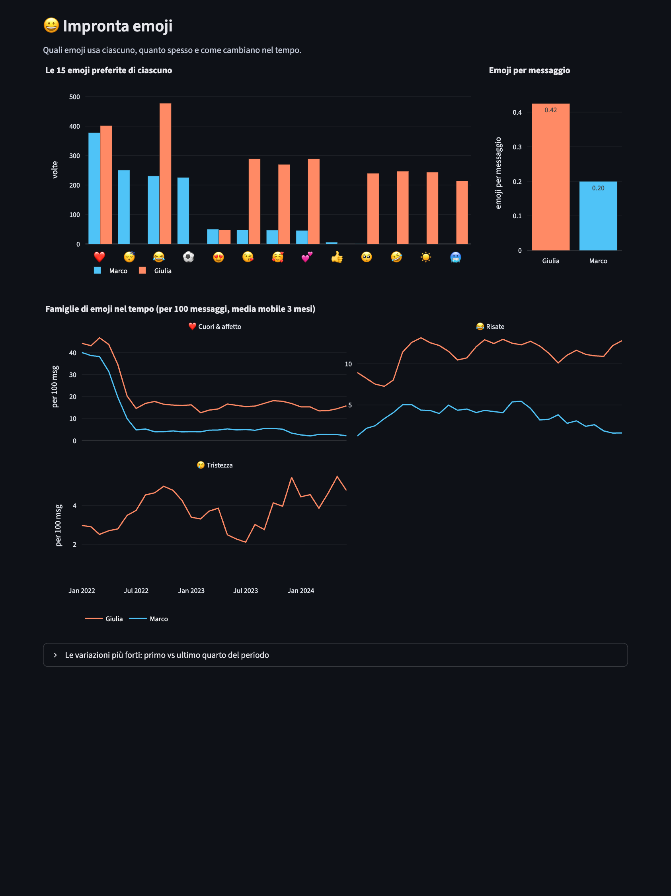</p>

**Parole identitarie** (TF-IDF × esclusività: il "dialetto" di ciascuno, intercalari e risate esclusi), ricerca
storica di qualsiasi parola, **soprannomi** con nascita, picco e scomparsa (più quelli scoperti automaticamente
accanto a cuori e parole d'amore), **impronta emoji** e famiglie di emoji nel tempo.

### 🕰️ Ritmi & Abitudini

<p align="center">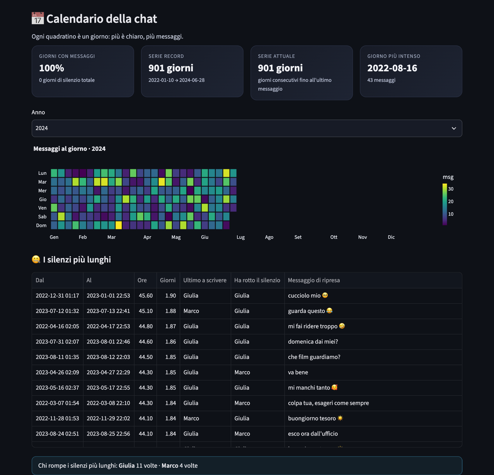</p>
<p align="center">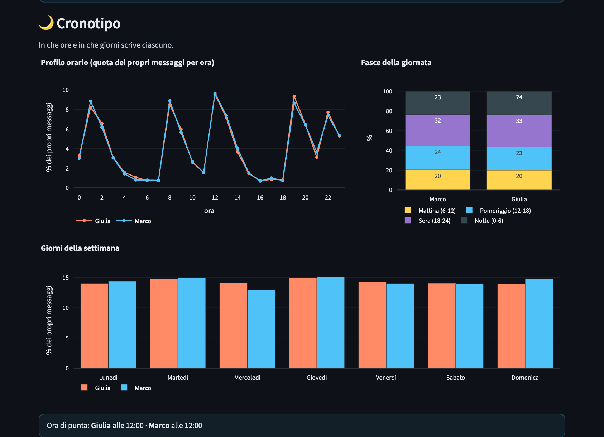</p>

Calendario giorno per giorno, serie record, **silenzi più lunghi** e chi li ha rotti, profilo orario, fasce della
giornata, giorni della settimana, mappa 7×24, indice "vampiro" (messaggi tra 01:00 e 05:30), chi accende le
conversazioni e dopo chi cala il silenzio, probabilità di risposta entro 3 minuti.

## Tutte le metriche, spiegate

<details>
<summary><b>Investimento e iniziativa</b></summary>

| Metrica | Definizione |
|---|---|
| Quota messaggi / caratteri | % del totale scritto da ciascuno; i caratteri pesano lo sforzo meglio dei messaggi |
| Lunghezza media e distribuzione | caratteri per messaggio di testo scritto di proprio pugno (media, mediana, percentili, fasce 1-5 … >350) |
| Domande ogni 100 messaggi | punti interrogativi per 100 messaggi di testo |
| Avvio conversazioni | chi scrive il primo messaggio dopo ≥ 6 ore di silenzio |
| Chiusura conversazioni | chi manda l'ultimo messaggio prima di una pausa > 6 ore |
| Inseguimento | catene di ≥ 2 (o ≥ 3) messaggi senza risposta distanziati ≥ 3 minuti |
| Mix dei canali | % di foto, vocali, video, sticker, GIF, documenti, posizioni, inoltri |
| Love bombing vs svalutazione | media delle variazioni % di volume, affetto, cuori, lunghezza e latenza tra primi e ultimi 60 giorni (>40 svalutazione marcata, 15-40 raffreddamento, ±15 stabile, < −15 intensificazione) |
</details>

<details>
<summary><b>Reattività</b></summary>

| Metrica | Definizione |
|---|---|
| Latenza | tempo tra un messaggio e la risposta dell'altro (solo cambi di mittente, pause > 8 h escluse) |
| Velocità | % di risposte entro 1 e 5 minuti, oltre 30 minuti e 2 ore |
| Fading detector | mediana ultimi 3 mesi vs mediana storica: segnalato se ≥ 1,5× e z robusto ≥ 2 (z = scarto / MAD×1,4826) |
| Dinamica delle risposte | P(B scrive entro 3 minuti \| A ha scritto) e latenza mediana della transizione |
</details>

<details>
<summary><b>Conflitto e red flag</b></summary>

| Metrica | Definizione |
|---|---|
| Tensione (0-100) | per sessione: lessico di conflitto/accusa, risposte < 15 caratteri o sticker, muri di testo > 350 caratteri, `?!` multipli, maiuscole, densità, con funzioni saturanti; ×0,4 se ≥ 30% dei messaggi ride |
| Soglia sessione tesa | 98° percentile della chat, tra 20 e 65 |
| Clima | affetto (+ cuori), conflitto, scuse, accuse ogni 1000 messaggi; rapporto affetto ÷ conflitto |
| Pronomi (Gottman) | quota di noi / io / tu sul totale dei tre; "tu sempre / tu mai" per 1000 parole |
| Stonewalling | messaggio > 350 caratteri scritto di proprio pugno → risposta < 15 caratteri, sticker/GIF o silenzio > 4 h; nei gruppi solo dialoghi 1-a-1 |
| Scuse / accuse | vocabolari curati, per 1000 messaggi, con esempi reali |
| Riappacificazione | dopo una sessione tesa seguita da > 4 h di silenzio: chi riscrive per primo, dopo quanto e se con delle scuse |
| Gaslighting, passivo-aggressività, colpevolizzazione | frequenza di frasi tipiche per 1000 messaggi, con esempi |
</details>

<details>
<summary><b>Lessico, affetto e ritmi</b></summary>

| Metrica | Definizione |
|---|---|
| Parole identitarie | TF-IDF sublineare (unigrammi + bigrammi) × esclusività (quota della parola scritta da quella persona) |
| Soprannomi | lessico affettivo + termini scoperti per *lift* ≥ 2,5 accanto a cuori/parole d'amore (saluti esclusi) |
| Impronta emoji | top emoji, emoji per messaggio, famiglie (cuori, risate, tristezza, fastidio) nel tempo |
| Calendario, serie, silenzi | messaggi al giorno, giorni consecutivi, pause più lunghe e chi le ha rotte |
| Cronotipo | % dei propri messaggi per ora, fascia e giorno; ora di punta |
| Indice reciprocità | 100 × (1 − media degli squilibri (max−min)/(max+min) su 7 indicatori di reciprocità); solo chat a due |
</details>

## AI Detective e modello locale

L'**AI Detective** è un agente con 5 strumenti, che l'LLM chiama in autonomia:

| Tool | Cosa fa |
|---|---|
| `get_global_psychometric_dossier` | dossier JSON con tutte le metriche (calcolate una volta e messe in cache) |
| `query_sql_database` | SQL **in sola lettura** sul database della chat, con timeout e limite di righe |
| `search_chat_sessions` | ricerca ibrida **BM25 (FTS5) + vettori (sqlite-vec)** fusi con Reciprocal Rank Fusion, filtrabile per persona, date e tensione |
| `analyze_specific_red_flag` | gaslighting, stonewalling, love bombing, passivo-aggressività, colpevolizzazione con esempi |
| `build_persona_profile` | profilo stilistico (lunghezze, punteggiatura, parole, emoji, messaggi reali) |

L'AI risponde nella lingua scelta per l'interfaccia (citando i messaggi nella lingua originale). Il **Persona Simulator** usa lo stesso profilo per generare risposte nello stile di un partecipante, o un dialogo di gruppo.

**Il modello si gestisce dalla barra laterale.** Scegli (⭐ = consigliato per la tua RAM), premi **Scarica e avvia**:
ChatAutopsy installa il backend se manca, scarica i pesi una sola volta con barra di avanzamento, avvia il server
OpenAI-compatible su `127.0.0.1` e lo riaccende da solo alle aperture successive. Il server si ferma quando chiudi l'app.

| RAM | Modello consigliato (MLX, 4-bit) | Download | Ollama |
|---|---|---|---|
| 8-16 GB | Qwen3.5 4B (marzo 2026) | 3,1 GB | `qwen3.5:4b` |
| 16-32 GB | Qwen3.5 9B (marzo 2026) | 6,0 GB | `qwen3.5:9b` |
| 32-96 GB | **Qwen3.8 27B** (agosto 2026) | 16,1 GB | `qwen3.8:27b` |
| ≥ 96 GB | Qwen3.5 122B-A10B (MoE) | 69,6 GB | `qwen3.5:122b-a10b` |

In alternativa, sempre dal pannello: **Qwen3.6 35B-A3B** (MoE con 3B parametri attivi: molto veloce, 20 GB) e
**Gemma 4 26B-A4B** (MoE, 15 GB). Il catalogo è in [`config.py`](chatautopsy/config.py) ed è facile da aggiornare.

- **MLX** (Mac Apple Silicon): automatico, `mlx-lm` viene installato se manca.
- **Ollama** (macOS/Linux): basta averlo installato da [ollama.com](https://ollama.com); ChatAutopsy lo avvia e scarica il modello.
- **Endpoint mio**: qualsiasi server OpenAI-compatible già attivo (LM Studio, vLLM, llama.cpp…).

## Riga di comando

```text
chatautopsy [--lang it|en]                   apre la dashboard (porta 8501)
chatautopsy analyze PERCORSO                 file/cartella/zip → database → dashboard
        --name NOME                          nome dell'analisi (default: dal file/cartella)
        --embeddings fast|quality|none       MiniLM (default) · bge-m3 · solo parole chiave
        --chat NOME                          chat da scegliere in un export Telegram completo
        --llm                                prepara anche il modello AI in background
        --no-open                            non aprire la dashboard
chatautopsy demo                             chat inventata (quella di questo README)
chatautopsy llm list                         catalogo: scaricati, consigliato, RAM
chatautopsy llm setup [MODELLO]              scarica e avvia (default: consigliato)
chatautopsy llm status | stop
chatautopsy list                             chat analizzate
chatautopsy wipe NOME [-y]                   cancellazione sicura
chatautopsy doctor                           dipendenze, GPU, modelli in cache
```

`./start.sh` accetta gli stessi comandi e prepara l'ambiente se serve.

## Architettura

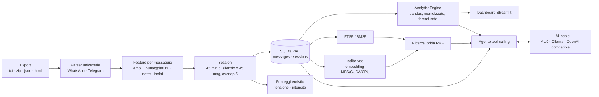

| Modulo | Ruolo |
|---|---|
| [`ingestion.py`](chatautopsy/ingestion.py) | parser, feature, sessioni, punteggi di tensione, scrittura DB, orchestrazione |
| [`analytics_engine.py`](chatautopsy/analytics_engine.py) | tutte le metriche, pagella, dossier per l'agente |
| [`rag_engine.py`](chatautopsy/rag_engine.py) | indice FTS5, embedding, ricerca vettoriale e ibrida |
| [`agent.py`](chatautopsy/agent.py) | agente in streaming con tool-calling (anche testuale stile Qwen) e simulatore |
| [`llm_manager.py`](chatautopsy/llm_manager.py) | catalogo modelli, download, avvio e salute del server |
| [`database.py`](chatautopsy/database.py) | schema, connessioni WAL, migrazioni, wipe sicuro |
| [`app.py`](chatautopsy/app.py), [`ui.py`](chatautopsy/ui.py) | dashboard e componenti grafici |
| [`cli.py`](chatautopsy/cli.py) | riga di comando |
| [`config.py`](chatautopsy/config.py) | soglie, lessici, catalogo modelli, percorsi |
| [`demo.py`](chatautopsy/demo.py) | chat sintetiche per demo e test |

<details>
<summary><b>Schema del database</b></summary>

- **messages**: un record per messaggio (timestamp, mittente, testo, conteggi, emoji, media, inoltro, gap e tempo di risposta).
- **sessions**: blocchi conversazionali con partecipanti, chi ha iniziato, durata, punteggio di tensione e intensità,
  quota di risate e trascrizione `[YYYY-MM-DD HH:MM] Nome: testo`.
- **fts_messages / fts_sessions**: indici full-text (unicode61, senza accenti).
- **session_embeddings**: vettori `vec0` (distanza coseno) con fallback NumPy.
- **meta**: sorgente, modello di embedding, conteggi.
</details>

## Prestazioni

Misure su Mac M3 Max (36 GB):

| Chat | Lettura | Database + punteggi | Ricerca semantica (MiniLM) | Prima apertura dashboard |
|---|---|---|---|---|
| demo, 12.820 messaggi | 0,3 s | ~5 s | ~20 s | pochi secondi |
| reale, 1,34 milioni di messaggi (Telegram HTML, 472 MB) | ~8 s | ~2 min | ~10 min | ~1 min (poi istantanea) |

Accorgimenti: regex lessicali compilate a **trie** (10-20× più veloci dell'alternanza ingenua, stessi risultati,
verificato nei test), un solo engine condiviso e memoizzato per tutte le sezioni, sezioni calcolate solo quando
aperte più precalcolo in background, WAL + `synchronous=NORMAL`, embedding a batch con rilascio periodico della
memoria MPS.

## Privacy e sicurezza

- **Nessun dato esce dal computer.** Le uniche connessioni sono il download una tantum dei pacchetti Python e dei
  modelli che scegli. A runtime Hugging Face è usato solo dalla cache locale; telemetria disattivata.
- **Gli export caricati non toccano il disco**: vengono letti in memoria; resta solo il database.
- **I database** stanno in `data/` (esclusa da git) o in `~/.chatautopsy/data`.
- **Wipe sicuro** (dashboard o `chatautopsy wipe`): checkpoint del WAL, sovrascrittura con zeri, fsync e
  cancellazione di `.db`, `-wal`, `-shm`. Su SSD/APFS la sovrascrittura non garantisce l'irrecuperabilità fisica
  (copy-on-write, snapshot di Time Machine): per la massima riservatezza usa un volume cifrato.
- **L'agente** ha accesso al database **in sola lettura** (blocco delle scritture e delle query multiple, timeout).
- Il server del modello ascolta solo su `127.0.0.1`.

## Configurazione

| Variabile | Default | Effetto |
|---|---|---|
| `CHATAUTOPSY_HOME` | repo (se sorgenti) o `~/.chatautopsy` | cartella base |
| `CHATAUTOPSY_DATA_DIR` | `$CHATAUTOPSY_HOME/data` | database, impostazioni, log |
| `CHATAUTOPSY_EMBED_MODEL` | MiniLM multilingue | modello di embedding predefinito |
| `CHATAUTOPSY_LLM_URL` / `_MODEL` / `_KEY` | `http://localhost:8080/v1` · Qwen3.8 27B | endpoint predefinito |
| `CHATAUTOPSY_MLX_PORT` | `8080` | porta del server MLX gestito |
| `CHATAUTOPSY_OLLAMA_URL` | `http://localhost:11434` | indirizzo di Ollama |
| `CHATAUTOPSY_CTX` | `32768` | contesto del modello (token) per il taglio della cronologia |
| `CHATAUTOPSY_LANG` | lingua del sistema | lingua dell'interfaccia: `it` o `en` |

Soglie e lessici sono in [`config.py`](chatautopsy/config.py), commentati.

## Sviluppo

```bash
make dev          # ambiente + pytest/ruff
make test         # test su chat sintetiche: nessun dato reale, nessuna rete
make test-all     # include gli embedding reali se il modello è in cache
make lint
python scripts/make_screenshots.py   # rigenera copertina e schermate IT + EN (richiede .[docs])
```

La suite copre i parser (inclusi casi limite Telegram HTML e WhatsApp USA), l'equivalenza trie/regex, l'intera
pipeline, tutte le metriche, la coerenza dell'engine condiviso, l'agente con un LLM simulato in streaming, la CLI,
il gestore dei modelli e il rendering di ogni sezione della dashboard. La CI gira su Python 3.11-3.13.

## FAQ e risoluzione problemi

<details>
<summary><b>L'AI Detective dice che il modello non risponde</b></summary>

Il modello non è avviato. Nel pannello **🤖 Modello AI locale** premi *Scarica e avvia* (o *Avvia* se è già
scaricato), oppure il pulsante nella sezione AI Detective. Da terminale: `./start.sh llm setup`. Se usi un tuo server,
attiva *Endpoint mio* e controlla URL e nome del modello. I log sono in `data/logs/llm_server.log`.
</details>

<details>
<summary><b>"Serve Python ≥ 3.10"</b></summary>

macOS include Python 3.9. Installa una versione recente (`brew install python@3.12` o da python.org): `start.sh`
la trova da solo, anche se non è nel PATH.
</details>

<details>
<summary><b>L'analisi è lenta o il Mac rallenta</b></summary>

La parte lenta è la ricerca semantica: usa `--embeddings none` (le statistiche non ne hanno bisogno) o il modello
*Veloce*. Chiudi app pesanti (simulatori, VM): sotto swap tutto rallenta di molte volte. `chatautopsy doctor` mostra
se la GPU (MPS) è in uso.
</details>

<details>
<summary><b>"Formato data non riconosciuto" con un export Telegram HTML</b></summary>

La lingua dell'export usa un formato di data non ancora supportato. Riesporta in **JSON** (date ISO, sempre
compatibili) e apri una issue con un esempio dell'attributo `title` della data (senza contenuti personali).
</details>

<details>
<summary><b>Posso analizzare chat di gruppo?</b></summary>

Sì: tutte le metriche funzionano con N partecipanti. Lo stonewalling conta solo i dialoghi 1-a-1, il grafo delle
risposte mostra chi risponde a chi, l'indice di reciprocità è riservato alle chat a due.
</details>

## Avvertenze

ChatAutopsy misura **comportamenti di scrittura**, non stati mentali né qualità di una relazione. Gli indicatori
lessicali non colgono ironia e contesto; i punteggi sono euristici; le risposte dell'AI possono sbagliare (controlla
sempre le citazioni). Nessun output è una valutazione clinica o psicologica. Analizza solo conversazioni di cui fai
parte e rispetta la riservatezza delle altre persone coinvolte.

## Licenza

[MIT](LICENSE) — contributi benvenuti.
